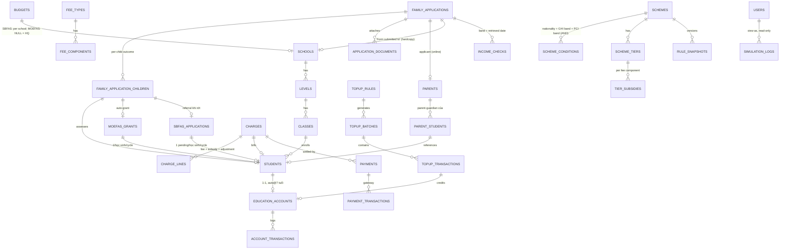

# Thiết kế hệ thống & Database — MOE Education Account & FAS

Đối chiếu: sheet **Requirement** (10 S/N, cột `Table` đang điền dần), **ProductBacklog** (epic US-001…059),
**AC** (Given/When/Then), prototype hiện tại (`src/data/*`), và [hardcopy-design.md](hardcopy-design.md).

## 1. Kiến trúc tổng thể

```
┌────────────────────┐   ┌────────────────────┐
│  Admin Portal      │   │  e-Service Portal  │
│  MOE HQ / School   │   │  Parent (SingPass) │
└─────────┬──────────┘   └─────────┬──────────┘
          └───────────┬────────────┘
                      ▼
            REST API (module mỗi epic)
                      ▼
     Domain services: Account · TopUp · Registry · Fee ·
     FAS Assessment · Budget · Simulation · Notification
                      ▼
                 Database (Postgres)
   ── Third-party (mock): SingPass/MyInfo-HOMES income ·
       Payment gateway · AI risk model · (email/SMS)
```

- **Hai portal, một backend, một database** — quyết định FAS của trường và những gì phụ huynh
  thấy luôn cùng nguồn sự thật (prototype đã làm đúng với fasStore dùng chung).
- Service **FAS Assessment** là engine trung tâm: vào → xin band thu nhập (Income API) → đối chiếu
  scheme (điều kiện AND, tier subsidy cao hơn thắng — AC-021-02, AC-024-03) → grant MOEFAS hoặc
  referral SBFAS. **Cả đơn online lẫn đơn giấy đi qua đúng engine này** (US-029).
- Service **Fee** tính lại phí khi FAS đổi (AC-026-03: hiện adjustment, không sửa im lặng).

## 2. Nguyên tắc thiết kế DB

1. **Lưu band, không lưu thu nhập chính xác** (AC-023-03) — privacy by design.
2. **Snapshot policy lúc xét**: scheme/rule đổi chỉ áp dụng cho assessment sau này (AC-021-03) →
   mọi assessment giữ `rule_snapshot_id`.
3. **Audit mọi quyết định**: ai nhập, ai duyệt, khi nào, lý do — enough để tái hiện một case.
4. **Chu kỳ = năm học** (form thật: hiệu lực tới hết tháng 12, nộp lại mỗi năm) — mọi ràng buộc
   "một đơn/học sinh" tính trong 1 cycle (AC-031 "same period").
5. **State machine tường minh** cho các entity sống dài: EducationAccount, FamilyApplication,
   SbfasApplication, TopUpBatch.
6. **RBAC + scoping**: mọi truy vấn school-side lọc theo `school_id` (AC-027-02); HQ thấy tất cả.

## 3. Mapping Requirement → Bảng (điền cột `Table` trong sheet)

| S/N | Bảng chính | Bảng phụ |
|---|---|---|
| 1 | `EducationAccounts` | `Students`, `AccountTransactions` (đóng tài khoản dư > 0 → bù sang nơi khác, US-016) |
| 2 | `TopUpRules`, `TopUpBatches`, `TopUpTransactions` | `EducationAccounts`, `Students` |
| 3 | `Schools`, `Levels`, `Classes`, `Students`, `FeeTypes`, `FeeComponents`, `Charges` | `ChargeLines` (subsidy/adjustment), `Payments`, `AccountTransactions` |
| 4 | `Schemes`, `SchemeConditions`, `SchemeTiers`, `TierSubsidies`, `FamilyApplications`, `FamilyApplicationChildren`, `MoefasGrants`, `SbfasApplications` | `IncomeChecks`, `RuleSnapshots`, `Charges` (tính lại) |
| 5 | `FamilyApplications` (channel='hardcopy') | `ApplicationDocuments` (scan PDF + giấy tờ), `IncomeChecks`, `SbfasApplications` (referral) |
| 6 | `Budgets` | `MoefasGrants`, `SbfasApplications` (statistics suy ra từ grant; không bảng riêng) |
| 7 | `SimulationLogs` | `Users` |
| 8 | `Parents`, `ParentStudents`, `EducationAccounts`, `AccountTransactions` | `AuditLogs` (sửa địa chỉ/liên hệ) |
| 9 | `Charges`, `Payments` | `PaymentTransactions` (gateway), `AccountTransactions` |
| 10 | `FamilyApplications`, `FamilyApplicationChildren` | `Parents`, `Students` |

Ghi chú: R5 **không có bảng riêng** — đơn giấy là `FamilyApplications` với `channel='hardcopy'`
+ bảng documents. Đây chính là quyết định thiết kế then chốt: *kênh là thuộc tính, không phải entity*.

## 4. ERD



## 5. Chi tiết bảng chính

### R1 — Education Account

```
education_accounts   : id PK, student_id FK UQ, status ENUM('Active','Closed'),
                       opened_at, closed_at, close_reason, balance DECIMAL
account_transactions : id PK, account_id FK, type ENUM('topup','fee_payment','refund','transfer_out','adjustment'),
                       amount, balance_after, ref_type/ref_id (topup | payment | charge), at
```
Job định kỳ: sinh nhật đủ 7 → create (SC-only); đủ 16 → close + dư > 0 tạo `transfer_out` (US-016).

### R2 — Top-up

```
topup_rules        : id PK, name, criteria JSONB {age range, balance range, schooling status},
                     amount, schedule ENUM('ad_hoc','monthly',...), status, created_by, ...
topup_batches      : id PK, rule_id FK NULL (ad-hoc), preview_count, preview_total,
                     executed_at, status ENUM('Preview','Executed','Failed')
topup_transactions : id PK, batch_id FK, account_id FK, amount, status ENUM('Completed','Failed'),
                     failure_reason, at      -- US-009 xem lịch sử đủ cả failed
```

### R3 — Registry & Fees

```
schools / levels / classes / students   : chuẩn phẳng; students.school_id qua classes
fee_types  : id PK, owner ENUM('MOE','School'), name          -- school component không được subsidise (MOE rule)
fee_components : id PK, fee_type_id FK, name, amount, effective_from
charges    : id PK, student_id FK, term, issued_at, due_at, status ENUM('Issued','PartiallyPaid','Paid','Waived')
charge_lines : id PK, charge_id FK, component_id FK, fee, subsidy DECIMAL DEFAULT 0,
              subsidy_source ENUM('MOEFAS','SBFAS'), payable, adjustment_reason NULL
             -- AC-026: mỗi dòng hiện fee/subsidy/payable; AC-026-03: FAS grant sau khi issued → dòng adjustment
payments   : id PK, charge_id FK, method ENUM('AccountBalance','Online'), amount, at
payment_transactions : id PK, payment_id FK, gateway_ref, status  -- online
```

### R4 + R5 + R10 — FAS (chi tiết đầy đủ ở [hardcopy-design.md](hardcopy-design.md))

```
schemes            : id, code ENUM('MOEFAS','SBFAS'), name, status, version
scheme_conditions  : scheme_id FK, nationality, ghi_band, pci_band      -- kết hợp AND (AC-021-02)
scheme_tiers       : scheme_id FK, tier, label
tier_subsidies     : tier_id FK, component_id FK, basis ENUM('percent','fixed'), value
rule_snapshots     : id, scheme_id, version, snapshot JSONB             -- AC-021-03
income_checks      : id, application_id FK, source ENUM('homes','paper_declared'),
                     ghi_band, pci_band, retrieved_at, status ENUM('ok','failed')  -- AC-023
family_applications: id, channel ENUM('eservice','hardcopy'), cycle, parent_id FK NULL,
                     school_id FK NULL, applicant_name/contact/email/address, comcare BOOL,
                     transport_mode ENUM, declaration_by/declaration_at, entered_by FK NULL,
                     entry_mode ENUM('manual','ocr'), ocr_verified_by/at NULL,
                     submitted_at, status ENUM('draft','assessing','on_hold','assessed','closed')
fam_application_children : id, application_id FK, student_id FK, rule_snapshot_id FK,
                     matched_condition INT NULL, outcome ENUM('moefas_granted','moefas_not_granted'),
                     moefas_tier, decided_at
moefas_grants      : student_id PK FK, tier, granted_at, effective_from, application_id FK,
                     rule_snapshot_id FK, cycle                       -- duyệt trước cuối tháng → tháng sau
sbfas_applications : id (SBFAS####), student_id FK, family_app_id FK, cycle,
                     source ENUM('eservice_referral','hardcopy_referral','sbfas_resubmission'),
                     attempt_no INT DEFAULT 1, supersedes_id FK NULL (đơn bị reject trước),
                     reapply_reason TEXT NULL (bắt buộc khi attempt_no > 1),
                     risk_score, risk_level ENUM('Low','Medium','High') (AI, US-053),
                     recommended_tier, sla_due, explanation, status ENUM('Pending','Approved',
                     'Overridden','Rejected'), sbfas_tier, justification, decided_at,
                     decided_by, parent_notified_at (AC-029-03)
application_documents : id, application_id FK, type ENUM('form_scan','income_docs','welfare_letter',...),
                     file_ref, uploaded_by, at                         -- AC-030: PDF-only + size limit
```

State machine FamilyApplication: `draft (scan+OCR prefill, staff xác nhận) → assessing →
(on_hold ⇄ assessing khi income API lỗi) → assessed`;
per-child: `moefas_granted` (kết thúc) | `moefas_not_granted → sbfas Pending → Approved/Overridden/
Rejected`; sau **Rejected** phụ huynh được nộp đơn SBFAS mới tại trường → `sbfas_resubmission`
(attempt 2+, `supersedes` đơn reject, bắt lý do) — tối đa **một Pending** mỗi học sinh mỗi cycle.
Trạng thái hiển thị danh sách (AC-027-01): Submitted / MOEFAS granted / Awaiting school decision /
SBFAS granted / Declined — suy ra từ 2 bảng children + sbfas, không cần cột riêng.

### R6 — Budget

```
budgets : id, scope ENUM('MOEFAS','SBFAS'), school_id FK NULL (SBFAS), cycle, amount,
          revised_from NULL, set_by, at      -- sửa budget lưu dòng mới hoặc history
```
Statistics (used/helped/by tier/by school) **suy runtime** từ `moefas_grants` + `sbfas_applications`
theo cycle — không lưu bảng tổng hợp; cảnh báo gần/nguyệt mức tính khi decide (US-036, vẫn ghi grant).

### R7 — Simulation

```
simulation_logs : id, hq_user_id FK, viewed_as ENUM('school','parent'), target_ref,
                  started_at, ended_at, screens TEXT[]   -- read-only session (US-039)
```

### R8 — Parent portal

```
parents        : id, name, nric, contact, residential_address, mailing_address, singpass_ref
parent_students: parent_id FK, student_id FK, relationship   -- 1 phụ huynh nhiều con, nhiều trường
```
Profile edit → ghi `audit_logs` (old→new, who=parent). AI assistant (US-056–059) stateless, không bảng.

### R9 — Payments: xem R3 (`payments`, `payment_transactions`, `account_transactions`).

### Users & audit (chung)

```
users : id, name, role ENUM('hq','school'), school_id FK NULL, status
audit_logs : id, actor_id FK, entity, entity_id, action, before JSONB, after JSONB, at
```

## 6. Mapping prototype store → bảng (khi chuyển backend)

| Store (src/data) | Bảng tương ứng |
|---|---|
| `registryStore` (schools/classes/students) | schools, classes, students |
| `students.ts` (+ `withBalance`) | students + education_accounts + account_transactions |
| `topupStore` | topup_rules/batches/transactions |
| `feeStore` + `fees.ts` | charges, charge_lines, payments |
| `moefas.ts` (tiers + rules, localStorage) | income tier reference + schemes/scheme_* + rule_snapshots |
| `fasStore.apps` | sbfas_applications |
| `fasStore.moefas` | moefas_grants |
| `fasStore.levels/sbfasBudget/history` + `budgets.ts` | budgets (+ history) |
| `sbfasStore.rules` | schemes (code='SBFAS', per school) — cần thêm `school_id` |
| `parentStore` | parents + parent_students + family_applications (channel eservice) |
| `FAMILIES` (seed tĩnh trong moefas.ts) | family_applications + children — nâng lên store thật |

## 7. Gợi ý API surface (cho cột "Expected API / Data" của Tracking File)

```
Auth:       POST /auth/sso/callback · GET /me
Registry:   GET/POST/PATCH /schools · /classes · /students
Accounts:   GET /accounts?search · GET /accounts/{id}/transactions
TopUp:      GET/POST /topup-rules · POST /topup-batches/preview · POST /topup-batches/{id}/execute
Fees:       GET/POST /fee-types · /components · POST /charges/assign · GET /students/{id}/charges
FAS:        GET/POST /schemes (+conditions/tiers/subsidies) · POST /fas/assess  (engine dùng chung)
            GET /fas/applications?channel=&status=&school=
            POST /fas/applications/hardcopy            (US-028, staff; body có entry_mode + ocr_ref)
            POST /fas/applications/{id}/documents      (US-030)
            GET /fas/sbfas/queue · POST /fas/sbfas/{id}/decide · /notify-parent
            POST /fas/sbfas/resubmit                   (nộp lại sau reject; body: reason, supersedes_id)
Budgets:    GET/PUT /budgets?scope=&school=&cycle · GET /budgets/statistics
Parent:     GET /parent/children · /charges · /transactions · PATCH /parent/profile
            POST /parent/pay (account | online) · POST /parent/fas/submit · GET /parent/fas/status
Simulate:   POST /simulate/start {as, target} · POST /simulate/end
Income(mock):POST /income/bands {nric[]} → {ghi_band, pci_band, retrieved_at}
```

## 8. Thứ tự triển khai đề xuất (khớp sprint)

1. **Sprint 2 (đang làm)**: schemas FAS (R4+R5+R10) là ưu tiên — engine assess dùng chung,
   family_applications có channel, referral tự động, documents.
2. **Sprint 2**: charges.charge_lines (subsidy + adjustment) để AC-026 khớp fee store hiện có.
3. **Sprint 3**: budgets + simulation_logs + AI fields (risk_level/recommended_tier đã đặt sẵn
   trong sbfas_applications nên thêm AI không đổi schema).

## 9. Điểm cần chốt với team/giảng viên

1. `sbfas_applications.source`: giá trị enum nên thống nhất (upstream đang dùng
   "MOE referral | Hardcopy" với nghĩa *hardcopy = không qua MOE* — mâu thuẫn AC-029-01; đổi
   semantics thì phải đổi cả seed + filter).
2. `on_hold` khi income API lỗi (AC-023-02) có đưa vào demo không.
3. Bảng `budgets` sửa amount có cần history (dòng mới) hay chỉ ghi audit_logs.
4. Charges: giữ `charge_lines` tách dòng (đề xuất) hay gộp subsidy JSONB trong charges (gọn hơn,
   nhưng khó query thống kê subsidy theo component).
5. **Nộp lại SBFAS sau reject** (luồng mới): có chặn sau N lần không; nộp lại có chạy lại xét
   MOEFAS khi hoàn cảnh thu nhập đổi không; kênh online có quyền nộp lại tương đương không
   (chi tiết mục 5 hardcopy-design.md).
